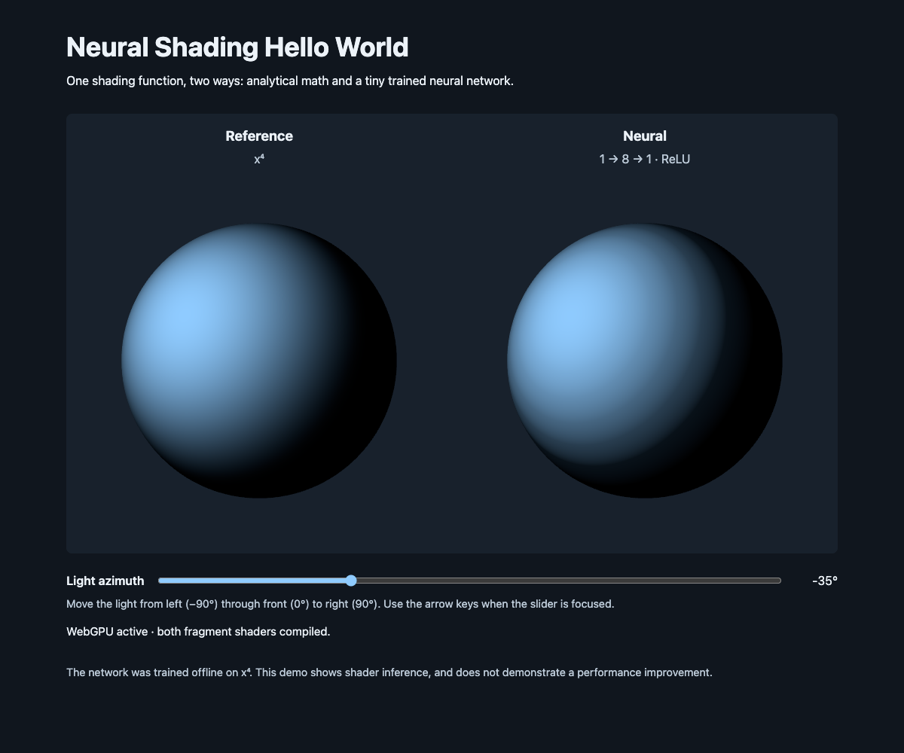
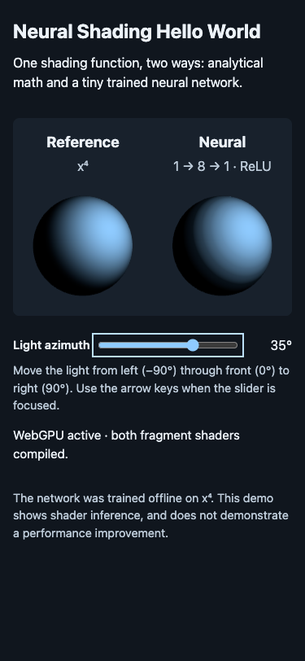

# Issue #3 validation

Source Issue: [Implement minimal neural shading demo](https://github.com/takahirox/three-nn/issues/3).

Implementation revision: **`efce709ff8e20bf7b4da8e52f4cb3933206e6635`**.
Checks below ran on that exact implementation tree on November 12, 2026. The
subsequent evidence commit adds only this report and screenshots; application,
weights, training, tests, manifest and lockfile remain identical. The final
checkpoint SHA is supplied in the GitWeave Result.

## Mandatory pre-merge acceptance

| Criterion | Implementation and actual evidence | Result |
| --- | --- | --- |
| AC1 — Runnable baseline | `npm install` completed with the pinned manifest/lockfile; `npm run dev -- --host 127.0.0.1` served the app on port 5173; `npm run build` produced `dist/`. README documents prerequisites and setup. | **Pass** |
| AC2 — Reference shading | Inspected `src/main.js` and the actual generated WebGPU fragment shader: normalized world-space normal and shared direction, clamped dot product, then `pow(..., 4.0)`. Both material outputs bypass built-in lighting and use the same clamp, base color and sRGB conversion without tone mapping. Visually inspected the reference sphere. | **Pass** |
| AC3 — Real neural shader | `src/neural-mlp.js` imports the committed JSON and constructs a TSL expression. Captured `GPUDevice.createShaderModule` descriptors during actual rendering: the neural `@fragment` entry contains all eight weighted `max(..., 0.0)` terms and the exported output bias. The reference power function is absent from the neural shader. No CPU inference or lookup texture is used for shading. | **Pass** |
| AC4 — Reproducible training | Created `.venv`, installed `training/requirements.txt`, and ran `.venv/bin/python training/train.py`. Reran with `--output /tmp/three-nn-regenerated-weights.json`; `cmp src/weights.json /tmp/three-nn-regenerated-weights.json` exited 0 (byte-identical). The committed file has 25 learned scalars. README documents seed, data, optimization, ordering, domains and rerun commands. | **Pass** |
| AC5 — Numerical accuracy | `npm test`: 2 tests passed, checking architecture/schema, array lengths, finite scalars, parameter count and 101 equally spaced inputs. Unclamped JavaScript **MAE 0.00268418**, **maximum absolute error 0.01103208**, below 0.03 / 0.10. PyTorch float32 export validation measured MAE 0.00268418 / maximum 0.01103216. | **Pass** |
| AC6 — Interactive comparison | Visually inspected side-by-side labeled, same-sized spheres. Sent a real browser ArrowRight key event to the focused range input: −35° → −34°, with matching output. Changed the shared control to +35° and inspected both highlights moving right without reload. Checked 1200px desktop and 375px narrow layout; at 375px, document scroll width was 375px, canvas width 343px and control stayed in bounds. | **Pass** |
| AC7 — GPU execution verified | Actual Chrome/Metal WebGPU execution, generated fragment shader inspection and manual screenshot inspection; environment and backend evidence below. Both materials compiled and rendered with no console/runtime errors on the normal path. Tested missing support and failed adapter paths, which visibly report failure and reject WebGL2 success. | **Pass** |
| AC8 — Focused validation | `npm test`, `npm run build`, development-server browser smoke and production browser smoke (`npm run preview -- --host 127.0.0.1`, port 4173) passed. The final production smoke included keyboard/slider, resize, error paths and recovery. `git diff --cached --check` passed for the implementation. No extra browser test dependency or CI framework was added. | **Pass** |
| AC9 — Documentation | Reviewed README against source: exact startup/training/test/build commands, architecture, weight schema, raw versus displayed outputs, accuracy limits and explicit absence of a demonstrated performance improvement are documented. Updated canonical guides' current-tooling descriptions. | **Pass** |

## Browser method and environment

- **Browser:** Chrome **157.0.8103.39**, isolated temporary profile in headless
  mode, driven through the Chrome DevTools Protocol. Screenshots and generated
  shader text were manually inspected. This was actual browser rendering on
  hardware; no software GPU flags or mocked shader backend were used.
- **OS:** macOS **27.2**, ARM64. Node **26.12.1**, npm **11.20.0**;
  Python **3.13.13**, PyTorch **2.9.1**, CPU training.
- **GPU:** the device used to configure the canvas reported adapter vendor
  **`apple`**, architecture **`metal-3`**, **`isFallbackAdapter: false`**.
  Device name/description were empty in the exposed adapter info.
- **Backend proof:** the application checks
  `renderer.backend.isWebGPUBackend` after `renderer.init()`. Test-only browser
  instrumentation observed the real `GPUCanvasContext.configure` call with
  format `bgra8unorm`, and captured the actual WebGPU shader-module descriptors.
  Both the analytical and learned expressions occur in `@fragment` entry
  points. The shared final output pass applies the sRGB conversion. The app
  awaited compilation, GPU submission and a validation error scope before
  reporting “WebGPU active · both fragment shaders compiled.”
- **Normal path:** both development and production builds reached that success
  state with no console errors or uncaught exceptions. Slider input changed
  shading without creating a new neural shader or reloading the page.
- **Failure paths:** a pre-navigation test hook hid `navigator.gpu`, then a
  separate hook made `requestAdapter()` resolve to `null`. Each produced a
  useful visible message, a disabled control and a hidden canvas. The second
  explicitly reported **“WebGL2 fallback rejected.”** Removing the hooks and
  reloading restored actual WebGPU rendering. Only these negative-path tests
  altered API availability; the successful GPU tests used the real API.

## Limitations and other checks

- **Pass:** two independent training runs produced byte-identical JSON. PyTorch
  emitted a benign warning about optional NumPy being absent; no NumPy API is
  used and no extra dependency is needed.
- **Pass:** final `npm install` reported zero known vulnerabilities. The initial
  Vite selection was updated to 7.3.8 after its dependency audit found advisories.
- **Pass with warning:** Vite's production bundle is about 777 kB before gzip
  (216 kB gzip), producing its default >500 kB chunk-size warning. This is the
  Three.js WebGPU bundle, and the build completes successfully.
- **Not run:** hosted CI; this repository has no configured CI workflow.
- **Skipped (optional):** GPU timings and additional browsers; outside the
  first demo's required scope. No performance claim is made.
- **Not run (additional coverage):** physical device loss and injected shader
  compilation failure. Error handlers exist, but these were not needed for the
  Issue's specified missing-support/initialization-failure smoke checks.
- Reproducibility across different CPU platforms/PyTorch releases is not claimed.

## Optional visual evidence

Production build, default −35° light direction:

375px layout with light changed to +35° and the slider focused:

## Required post-merge verification

None required.
