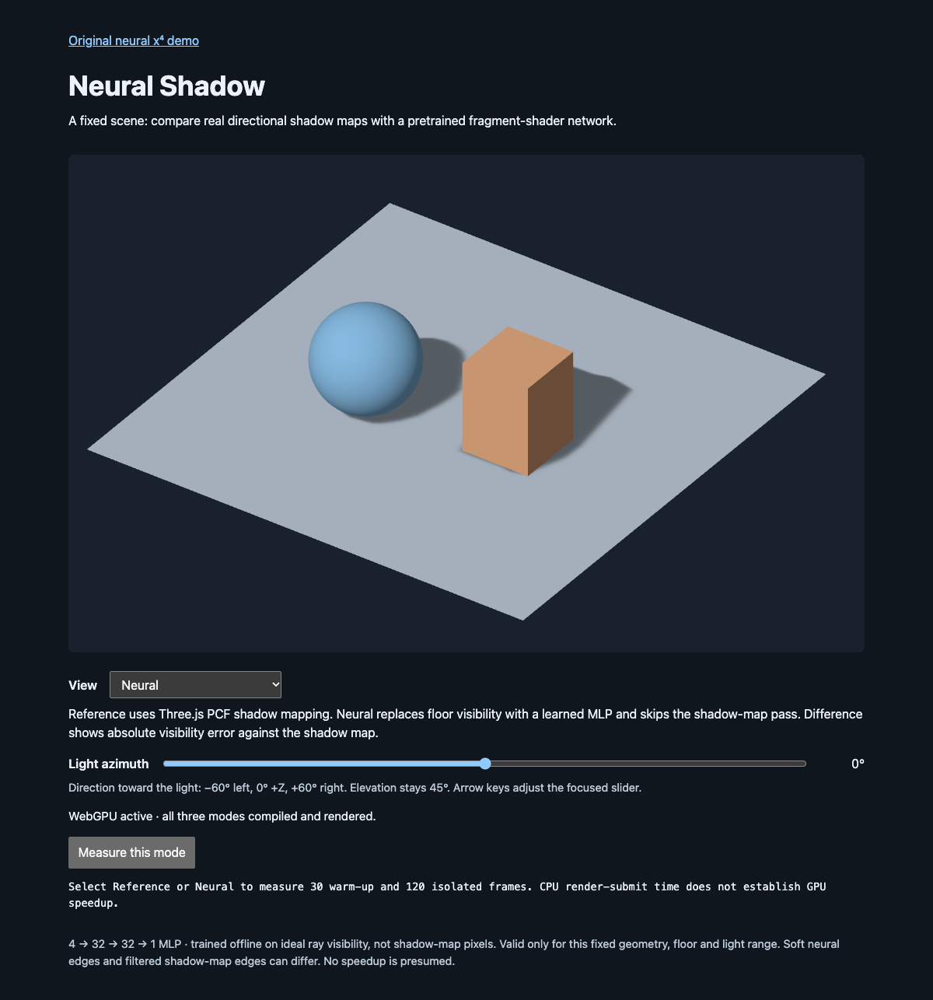
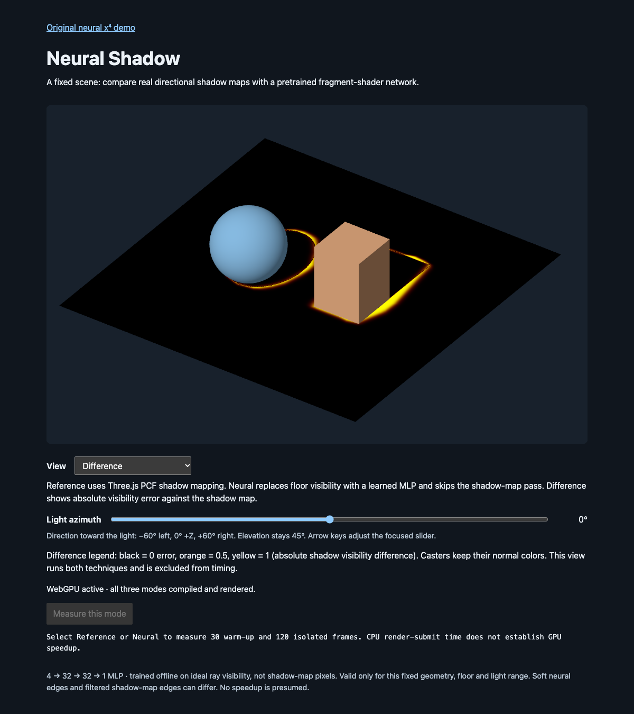

# Issue #5 validation

Source: [Neural Shadow](https://github.com/takahirox/three-nn/issues/5).
Implementation revision: **`80b4a39f717a8fcaa8767e13ffb87e414c37a5aa`**.
Checks below cover that implementation on November 12, 2026. The subsequent
report commit adds only this evidence, screenshots and raw timing JSON; runtime,
training, weights, tests and build configuration remain unchanged. The final
checkpoint SHA is supplied in the GitWeave Result.

## Mandatory pre-merge acceptance

| Criterion | Implementation and actual evidence | Result |
| --- | --- | --- |
| AC1 — Preserve baseline | Original `src/main.js`, `neural-mlp.js`, weights and tests are unchanged. `npm test` preserves MAE 0.00268418 / maximum error 0.01103208. Both `/` and `/shadow.html` reached WebGPU success on dev (5174) and production preview (4185). Reciprocal links make both discoverable. Vite multi-page output contains both HTML entries. | **Pass** |
| AC2 — Real reference shadows | `shadow-demo.js` creates the fixed floor/sphere/box from shared JSON, one DirectionalLight and ambient term. Both casters have `castShadow=true`, ground has `receiveShadow=true`, reference enables renderer shadow maps and light shadow casting. Its fragment graph uses Three.js `shadow(light)` with 1024² PCF maps and documented bias. Actual browser GPU render-pass instrumentation observes three passes: shadow, scene, output. Visible shadows move with light direction. | **Pass** |
| AC3 — Actual neural replacement | Neural fragment WGSL has 64 ReLU operations, the exported row dot products and sigmoid; no shadow-map sampling. Neural disables renderer shadow maps, light shadow casting and shadow updates, and actual GPU render-pass count drops from three to two (scene/output). Switching back restores three. Float-target GPU probe readback agrees with the exported Python/JS model; details below. | **Pass** |
| AC4 — Reproducible offline training | Installed existing pinned Python requirements. Ran `.venv/bin/python training/train-shadow.py`, regenerated with `--output /tmp/three-nn-shadow-final-regenerated.json` and compared with `cmp`: byte-identical. `--validate-only` passed again at the recorded revision. Both languages read the same scene JSON; basic teacher geometric cases pass. Browser works from committed weights with no Python service. | **Pass** |
| AC5 — Held-out accuracy | Independent JS ray teacher and CPU network evaluate 3,072 stratified samples, 1,536 shadowed / 1,536 lit, at −40°, 0°, +40°. Aggregate MAE **0.011563056**, shadow IoU **0.987749839**, above 0.70. Per-angle values below. No stored training labels are used by JS validation. | **Pass** |
| AC6 — Interactive modes | Switched Reference → Neural → Difference → Reference and moved light through −60°, +40°, +60° in production; all modes stayed operational. Real CDP ArrowRight key input changed the native slider from 0° to 1°, with updated output. Difference displays a visibility-error legend and disables measurement. At 375px viewport, scroll width remains 375px and canvas is 343px wide. | **Pass** |
| AC7 — Matched lighting | Reference and Neural use exactly the same floor expression, material type, linear base color, camera, geometry, sRGB output, no tone mapping, pixel ratio and antialiasing. Only visibility changes. Ambient remains unshadowed. Difference normalizes absolute linear floor-color difference by common base/direct illumination. README explains ideal teacher versus filtered map/bias/tessellation differences. | **Pass** |
| AC8 — Reproducible cost comparison | Production measurements at 1024×640 physical pixels, 0° azimuth, 30 warm-up / 120 sampled frames per isolated mode. Supported GPU timestamp queries sum all rendering passes. Reference median **0.393216 ms GPU / 0.500000 ms CPU render-submit**; Neural **1.310720 ms GPU / 0.300000 ms CPU render-submit**. No neural GPU speedup. Method, limitations and raw JSON below. | **Pass** |
| AC9 — Build/tests/browser | `npm ci`, `npm test` (5 tests), `npm run build`, training, independent validation, dev browser smoke and production browser smoke completed. Actual Chrome/Metal WebGPU backend verified. Missing support, failed adapter, shader compilation failure and device loss all display recovery errors, disable controls and hide canvas. WebGL2 fallback is explicitly rejected. | **Pass** |
| AC10 — Scope/docs | README documents both entries, single scene, L convention, exact geometry/shadow settings, architecture and ordering, teacher, training/sampling, metrics, limitations, browser requirements, difference interpretation and isolated timing. No new runtime dependency, GUI framework, physics, scene loading or path tracer. | **Pass** |

## Numeric validation

`npm test` passes five tests, including the two unchanged Issue #3 checks. The
new tests check all 1,249 finite model parameters and shapes, normalization and
scene version, geometric known cases, independent CPU inference and Python/JS
numeric probes, then independently generate ideal-ray labels for evaluation.

| Angle | Samples | Shadowed | Lit | JS visibility MAE | JS shadow IoU |
| --- | --- | --- | --- | --- | --- |
| −40° | 1,024 | 512 | 512 | 0.009872947 | 0.990291262 |
| 0° | 1,024 | 512 | 512 | 0.013256097 | 0.986486486 |
| +40° | 1,024 | 512 | 512 | 0.011560123 | 0.986486486 |
| Aggregate | 3,072 | 1,536 | 1,536 | 0.011563056 | 0.987749839 |

These are independently selected cell centers, balanced by class; they do not
estimate uniform floor-area error. The exact evaluation angles are excluded from
training. Shadow prediction uses visibility <0.5. The teacher is ideal ray
visibility, **not captured Three.js shadow-map pixels**. PyTorch float32 validation
reports aggregate MAE 0.011563052 / IoU 0.987749815; the tiny difference from JS
float64 is expected.

**Pass:** `training/train-shadow.py` and `--validate-only` execute known contact,
projected sphere shadow, far outside and azimuth-sign teacher cases. Full training
and the independent regeneration met the IoU gate and produced identical JSON.
PyTorch emits a benign optional-NumPy warning; this script needs no NumPy API.

## Browser method and environment

- Chrome **157.0.8103.39**, isolated temporary headless profile driven through
  Chrome DevTools Protocol; macOS **27.2**, **ARM64**.
- Actual GPU device reports vendor **apple**, architecture **metal-3**,
  **isFallbackAdapter=false**; device/description strings are blank. No software
  GPU or unsafe WebGPU flags were used.
- Node **26.12.1**, npm **11.20.0**, Python **3.13.13**, PyTorch **2.9.1** (CPU).
- `npm run dev -- --host 127.0.0.1` served this worktree at port **5174** because
  5173 was already occupied. `npm run preview -- --host 127.0.0.1 --port 4185 --strictPort`
  served the built artifact. Tests accessed these specific ports.
- App checks `renderer.backend.isWebGPUBackend`. Browser test instrumentation
  observes actual `GPUCanvasContext.configure`, `GPUDevice.createShaderModule`
  and `GPUCommandEncoder.beginRenderPass`. Initialization awaits compilation,
  submitted work and a WebGPU validation error scope for every mode before success.
- Generated Neural WGSL's `@fragment` takes interpolated world position and
  contains **64 `max` activations**, weighted vec4 dot products and `exp` for
  sigmoid. There is **no `textureSampleCompare`** in that shader; Difference
  contains both inference and shadow comparison. JS does no runtime raycasting.
- A separate test renderer imported the same `neuralVisibility` TSL function,
  rendered each of the **eight committed probes** to a 1×1 RGBA float target and
  read back the red channel with `readRenderTargetPixelsAsync`. Maximum absolute
  discrepancy from Python float32 was **4.47×10⁻⁷**, including nonsaturated edge
  predictions. `npm test` independently checks the same export with JS CPU math
  (tolerance 2×10⁻⁵). Validation scope and console reported no GPU errors.
- **Pass:** normal dev and production rendering, mode changes, changing light,
  native keyboard slider operation and desktop/narrow layout. Screenshots were
  inspected. Normal-path browser console and uncaught exception collections empty.
- **Pass:** test hooks separately hid `navigator.gpu`, made `requestAdapter()`
  return null and supplied invalid WGSL. Each produced an actionable error,
  disabled controls and hidden canvas. Failed adapter explicitly reports
  “WebGL2 fallback rejected”. Destroying only the isolated test page's actual
  GPUDevice exercised the device-loss recovery message and disabled controls.
- **Pass:** requesting a device without the optional timestamp-query feature
  still renders on actual WebGPU. Its benchmark records GPU time **unavailable**
  (`null`) and clearly labels CPU render-submit time. Negative-path hooks were
  absent from the successful rendering and representative timing runs.

## Isolated timing results

[Raw timing records](shadow-timings.json) come from the production build at the
implementation revision above. Both use a **1024×640** physical-pixel canvas,
viewport 1200px wide, device pixel ratio 1, **0° azimuth / 45° elevation**, same
orthographic camera/framing, same mesh geometry/colors and common output settings.
Reference uses a **1024² PCF** map with **−0.0002 bias / 0 normal bias**, updated
each sampled frame (Three.js's default auto-update behavior). Neural skips it.

| Isolated mode | Warm-up | Sampled frames | Median CPU render-submit | Median GPU render-pass sum |
| --- | --- | --- | --- | --- |
| Reference | 30 | 120 | 0.500000 ms | 0.393216 ms |
| Neural | 30 | 120 | 0.300000 ms | 1.310720 ms |

The UI's **Measure this mode** runs one selected method per animation frame.
CPU `performance.now()` brackets synchronous `renderer.render()` only. After each
submission, Three.js resolves timestamp queries and waits for the GPU outside
that CPU timer. Timestamp durations are summed across the shadow (Reference),
main scene and common output passes. This was confirmed against Three.js 0.181.1's
query-pool implementation, which groups and sums pass durations by frame.
Difference is disabled for measurement and is never included in either result.

These are isolated-render medians, not displayed FPS, throughput under queued
work or complete browser/compositor latency. Timestamp results are quantized by
the browser, and the short runs are exploratory, environment-specific evidence.
**Neural GPU rendering is slower here.** Lower CPU submission time does not imply
GPU speedup. More casters or higher shadow resolution change the shadow-map cost;
more receiver pixels or a larger MLP change neural cost. No universal performance
claim follows from this one fixed scene/device.

To reproduce, run the production preview, keep window size/device/angle fixed,
select each method and use its measurement button. The output includes physical
resolution, backend, adapter, settings and sample counts. In DevTools,
`shadowDemo.diagnostics()` also renders once and reports three reference render
calls versus two neural calls, including the common output pass.

## Other checks and limitations

- **Pass:** `git diff --cached --check`, complete source/JSON contract review,
  local documentation link checks and consistency review. No dependency changes.
- **Pass with warning:** production Vite build; its shared Three.js WebGPU chunk
  exceeds Vite's default 500 kB warning threshold, as in the baseline. Build
  completes and both entries render from preview.
- **Not run:** hosted CI, because the repository has no configured CI workflow.
- **Skipped (optional):** video and additional browsers/devices. Fixed-scene
  accuracy and performance do not establish behavior on other geometry/hardware.
- No remaining mandatory pre-merge check is pending for this implementation.

## Optional visual evidence

Production build, same camera and 0° light azimuth. Differences concentrate at
shadow boundaries; the MLP's soft transitions are visible.

Reference:

Neural:

Difference (black zero error, orange intermediate, yellow full disagreement):

## Required post-merge verification

None required.
